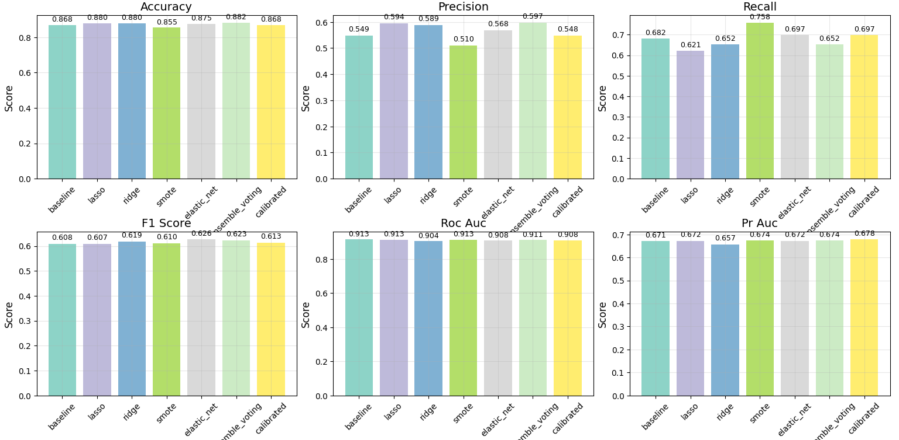

# Marketing Campaign Response Prediction

Which customers will respond to the next marketing campaign? This project predicts campaign response for 2,201 retail customers, where only **15% respond**, and compares 8 classifiers built to handle that imbalance. Built for Statistical Machine Learning at Inha University (Spring 2025).



## Results

Test set: 441 customers (20% stratified hold-out). Each logistic model's decision threshold is tuned for F1.

| Model | Accuracy | Precision | Recall | F1 | ROC-AUC | PR-AUC |
| --- | ---: | ---: | ---: | ---: | ---: | ---: |
| Logistic regression (baseline) | 0.869 | 0.549 | 0.682 | 0.608 | **0.914** | 0.671 |
| Lasso (L1) | 0.880 | 0.594 | 0.621 | 0.607 | 0.913 | 0.672 |
| Ridge (L2) | 0.880 | 0.589 | 0.652 | 0.619 | 0.904 | 0.657 |
| SMOTE oversampling | 0.855 | 0.510 | **0.758** | 0.610 | 0.913 | 0.674 |
| Elastic Net | 0.875 | 0.568 | 0.697 | **0.626** | 0.908 | 0.672 |
| Soft-voting ensemble | **0.882** | **0.597** | 0.652 | 0.623 | 0.911 | 0.674 |
| Probability-calibrated | 0.869 | 0.548 | 0.697 | 0.613 | 0.908 | **0.678** |
| Random Forest (class-balanced) | 0.850 | — | — | — | 0.910 | — |

The Random Forest row uses the default 0.5 threshold. At its ROC-optimal threshold (0.36) it catches **89% of responders** (recall 0.89, precision 0.41, F1 0.56), which suits campaigns where a missed responder costs more than an extra mailing.

**What drives response.** The strongest predictors in the Random Forest are days since last purchase (Recency), customer tenure, spending on wine and meat, income, and whether the customer accepted earlier campaigns 3 and 5.

**Choosing a model.** Use the ensemble when the budget is tight and precision matters, SMOTE or the tuned Random Forest when reaching every likely responder matters, and Elastic Net for the best overall balance (F1).

## Data

`data/marketing_campaign_clean.csv`: 2,201 customers × 27 columns, derived from the public [Customer Personality Analysis](https://www.kaggle.com/datasets/imakash3011/customer-personality-analysis) dataset.

- **Demographics**: age, education, marital status, income, children and teenagers at home
- **Behaviour**: tenure (`Total_Period`, days), recency, spending in 6 product categories, purchases by channel (web, catalog, store, deals), web visits
- **Campaign history**: acceptance of 5 earlier campaigns, complaints
- **Target**: `Response` (1 = accepted the latest campaign)

## Method

1. One-hot encode categorical features, standardize, stratified 80/20 split (`random_state=42`).
2. Fit logistic regression with L1, L2 and Elastic Net penalties, tuned by 5-fold stratified cross-validation.
3. Handle imbalance three ways: SMOTE oversampling, class weights, and threshold tuning on predicted probabilities.
4. Combine models in a soft-voting ensemble and calibrate probabilities.
5. Grid-search a class-balanced Random Forest (216 combinations × 5 folds, F1 scoring).

## Run

```bash
pip install -r requirements.txt
python src/logistic_regression_models.py   # 7 logistic models → results/, figures/generated/
python src/random_forest_balanced.py       # Random Forest → figures/generated/, models/
```

Run from the repository root. Both scripts use fixed random seeds and reproduce the numbers above.

## Repository structure

```
data/      cleaned dataset
src/       logistic-regression pipeline and Random Forest script
figures/   ROC, precision-recall, confusion-matrix, calibration and feature-importance charts
results/   model comparison table
```

## Tech stack

Python · scikit-learn · imbalanced-learn (SMOTE) · pandas · NumPy · Matplotlib · Seaborn

## Author

Enkhbayar Amarsanaa · B.S. Data Science, Inha University · [LinkedIn](https://linkedin.com/in/enkhbayar-am)
